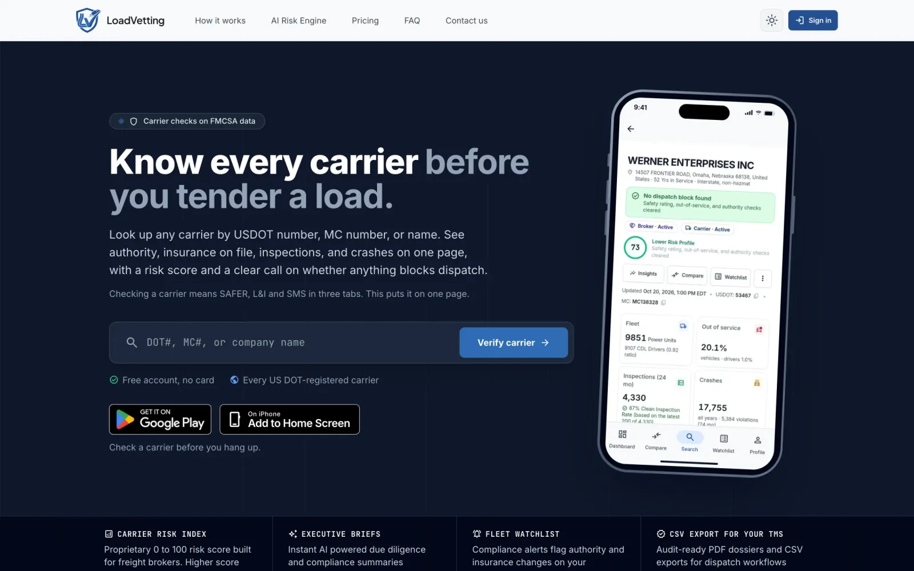
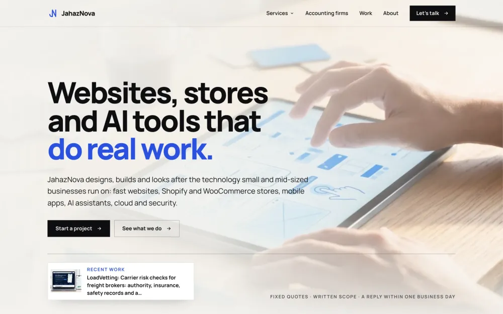
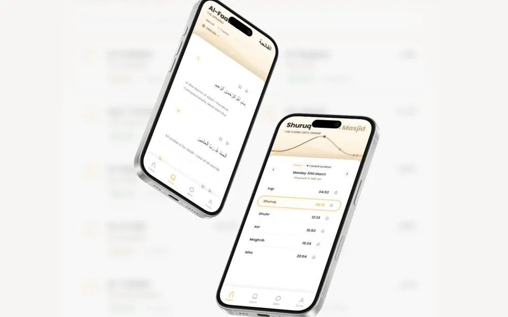
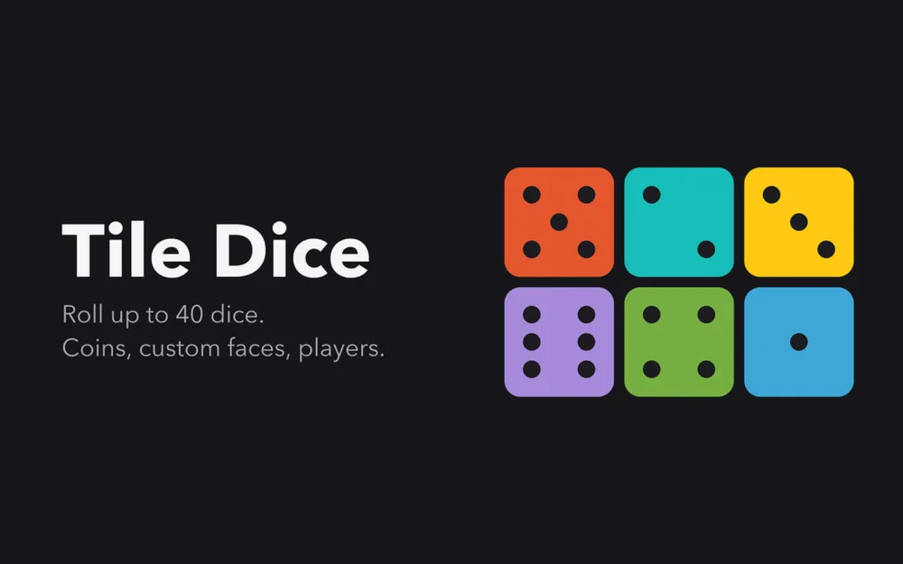
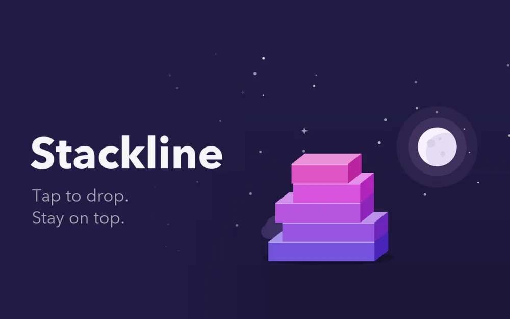

<a href="https://fb.cresstech.ae">
  <picture>
    <source media="(prefers-color-scheme: dark)" srcset="assets/banner-dark.svg">
    <source media="(prefers-color-scheme: light)" srcset="assets/banner-light.svg">
    
  </picture>
</a>

  <a href="https://fb.cresstech.ae"><b>Portfolio</b></a>
  &nbsp;·&nbsp;
  <a href="https://linkedin.com/in/farhanbashir"><b>LinkedIn</b></a>
  &nbsp;·&nbsp;
  <a href="https://play.google.com/store/apps/developer?id=znz"><b>Google Play</b></a>
  &nbsp;·&nbsp;
  <a href="mailto:fb@cresstech.ae"><b>fb@cresstech.ae</b></a>

 

I started as a web designer in 2008 and never stopped at the design file. These days I take a product from the
first sketch to the app store: the interface, the API, the database, the payments and the deploy.

Along the way I led UI for enterprise SaaS and analytics platforms, built stores and government platforms, and
published my own apps. Now I run two startups of my own.

> [!NOTE]
> **Right now:** building [LoadVetting](https://loadvetting.com/), carrier risk scoring for freight brokers, and
> running [JahazNova](https://jahaznova.com/), my design and technology studio.

## Things I built and own

### [LoadVetting](https://loadvetting.com/)

Carrier risk scoring for freight brokers. Search a motor carrier by DOT or MC number and see its authority,
insurance, safety record and risk score on one page.

`Next.js` `Supabase` `Stripe` `TanStack Query` `Trusted Web Activity` &nbsp; [Web](https://loadvetting.com/) · [Google Play](https://play.google.com/store/apps/details?id=com.loadvetting.app)

<table>
  <tr>
    <td width="50%" valign="top">
      
      <h3><a href="https://jahaznova.com/">JahazNova</a></h3>
      
My design and technology studio: websites, Shopify and WooCommerce stores, mobile apps and AI tools for small businesses, each with a fixed quote.

      
<code>WordPress</code> <code>Brand and copy</code> <code>SEO</code>

    </td>
    <td width="50%" valign="top">
      
      <h3><a href="https://thequranflow.vercel.app/">QuranFlow</a></h3>
      
A Quran-centred app for daily use, with adhan and Qibla. Portrait-first and offline-aware. <a href="https://play.google.com/store/apps/details?id=com.jahaznova.qflowai">Google Play</a>

      
<code>Angular</code> <code>RxJS</code> <code>Capacitor</code> <code>Supabase</code>

    </td>
  </tr>
  <tr>
    <td width="50%" valign="top">
      
      <h3><a href="https://play.google.com/store/apps/details?id=com.jahaznova.tiledice">Tile Dice</a></h3>
      
A full-screen dice roller for board and party games: up to 40 dice as bold colour tiles, with matching results joined up.

      
<code>Flutter</code> <code>Dart</code> <code>Riverpod</code>

    </td>
    <td width="50%" valign="top">
      
      <h3><a href="https://play.google.com/store/apps/details?id=com.jahaznova.stackline">Stackline</a></h3>
      
A one-tap stacking game: drop each block, trim the overhang and climb through five worlds. The blocks in the banner above are borrowed from it.

      
<code>Flutter</code> <code>Flame</code> <code>Dart</code>

    </td>
  </tr>
</table>

## Built for others

| | | |
|---|---|---|
| **[Soft Skill Hour](https://www.softskillhour.com/)** | A membership learning platform: a storefront, a shared signup app and a members' course dashboard on one Supabase backend. | `Next.js` `Turborepo` |
| **[ImageOpti](https://www.imageopti.com/)** | Free image tools that run entirely in the browser. Compress, resize, crop and convert, and the files never leave the device. | `Next.js` `TypeScript` |
| **[tempboxs](https://tempboxs.com/)** | A disposable email inbox with no signup. Messages are sanitized and remote images removed. | `Next.js` `TypeScript` |
| **[NazSecure Financial](https://nazsecure.com/)** | Marketing and lead-generation site for a wealth management and insurance firm. | `Next.js` `Tailwind` |
| **Shops Master 2.0** | An admin console that runs thousands of storefronts from one hub: dashboards, pricing, tax and role-based access. | `Vue 3` `TypeScript` |

More, with screenshots and write-ups, at **[fb.cresstech.ae/work](https://fb.cresstech.ae/work)**.

## The stack, end to end

| | |
|---|---|
| **Frontend** | React, Next.js, Angular, Vue 3, Nuxt, TypeScript, Tailwind, shadcn |
| **Backend and data** | Node.js, PHP, REST, GraphQL, WebSocket, MySQL, MongoDB, Supabase |
| **Mobile** | Flutter, Flame, Capacitor, Trusted Web Activity, PWAs |
| **Commerce and payments** | Shopify and Liquid, Shopify Plus checkout, WooCommerce, WordPress Multisite, Stripe, PayPal, Checkout.com |
| **Delivery** | AWS, Docker, Vercel, CI/CD, Core Web Vitals, WCAG 2.1 |

## How I work now

Most of what I build is built with AI coding agents such as Claude and Codex. I write the specs and direct the
agents. The architecture, the review, the UX quality and the shipping stay with me.

<b>A few repos worth opening</b>

 

- **[portfolio](https://github.com/frank1006/portfolio)**: my site. Next.js 16 and plain CSS, with no UI framework and no animation library.
- **[atv-kit](https://github.com/frank1006/atv-kit)**: an Apple TV-style home screen for Android TV. Clean, ad-free, with weather and screen mirroring.
- **[ng-quran](https://github.com/frank1006/ng-quran)**: a Quran reader built with Angular. [Live](https://ng-quran.vercel.app)

## Let's talk

Open to senior and lead engineering roles, full-stack or frontend, and to freelance and contract work. Fully remote.

  <a href="mailto:fb@cresstech.ae"><b>fb@cresstech.ae</b></a>
  &nbsp;·&nbsp;
  <a href="https://linkedin.com/in/farhanbashir"><b>LinkedIn</b></a>

