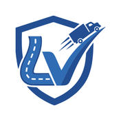
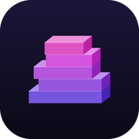

<a href="https://fb.cresstech.ae">
  <picture>
    <source media="(prefers-color-scheme: dark)" srcset="assets/banner-dark.svg">
    <source media="(prefers-color-scheme: light)" srcset="assets/banner-light.svg">
    
  </picture>
</a>

  <a href="https://fb.cresstech.ae"><b>Portfolio</b></a> ·
  <a href="https://linkedin.com/in/farhanbashir"><b>LinkedIn</b></a> ·
  <a href="https://play.google.com/store/apps/developer?id=znz"><b>Google Play</b></a> ·
  <a href="mailto:fb@cresstech.ae"><b>Email</b></a>

I started as a web designer in 2008 and never stopped at the design file. Today I take a product from the first sketch to the app store: the interface, the API, the database, the payments and the deploy.

I run [JahazNova](https://jahaznova.com/), my design and technology studio, and build most things with AI coding agents while keeping the architecture, the review and the UX quality in my own hands.

## Apps I built and own

###  LoadVetting

Carrier risk scoring for freight brokers: authority, insurance, safety record and a risk score on one page. `Next.js` `Supabase` `Stripe` · [Web](https://loadvetting.com/) · [Google Play](https://play.google.com/store/apps/details?id=com.loadvetting.app)

###  QuranFlow

A Quran-centred app for daily use, with adhan and Qibla. Portrait-first and offline-aware. `Angular` `Capacitor` `Supabase` · [Web](https://thequranflow.vercel.app/) · [Google Play](https://play.google.com/store/apps/details?id=com.jahaznova.qflowai)

###  Tile Dice

A full-screen dice roller for board and party games: up to 40 dice as bold colour tiles. `Flutter` `Riverpod` · [Google Play](https://play.google.com/store/apps/details?id=com.jahaznova.tiledice)

###  Stackline

A one-tap stacking game: drop each block, trim the overhang and climb through five worlds. `Flutter` `Flame` · [Google Play](https://play.google.com/store/apps/details?id=com.jahaznova.stackline)

Also mine:

- **[ImageOpti](https://www.imageopti.com/)**: image tools that run entirely in the browser.
- **[tempboxs](https://tempboxs.com/)**: a disposable email inbox with no signup.

## Built for others

- **[Soft Skill Hour](https://www.softskillhour.com/)**: a membership learning platform on Next.js and Supabase.
- **[NazSecure Financial](https://nazsecure.com/)**: a lead-generation site for a wealth and insurance firm.

More at **[fb.cresstech.ae/work](https://fb.cresstech.ae/work)**.

## Stack

- **Web:** React, Next.js, Angular, Vue 3, TypeScript, Node.js, Supabase
- **Mobile:** Flutter, Capacitor, PWAs
- **Commerce:** Shopify, WooCommerce, Stripe, PayPal, Checkout.com

## Let's talk

Open to senior and lead engineering roles, full-stack or frontend, and to freelance work. Fully remote.

**[fb@cresstech.ae](mailto:fb@cresstech.ae)** · **[LinkedIn](https://linkedin.com/in/farhanbashir)**
